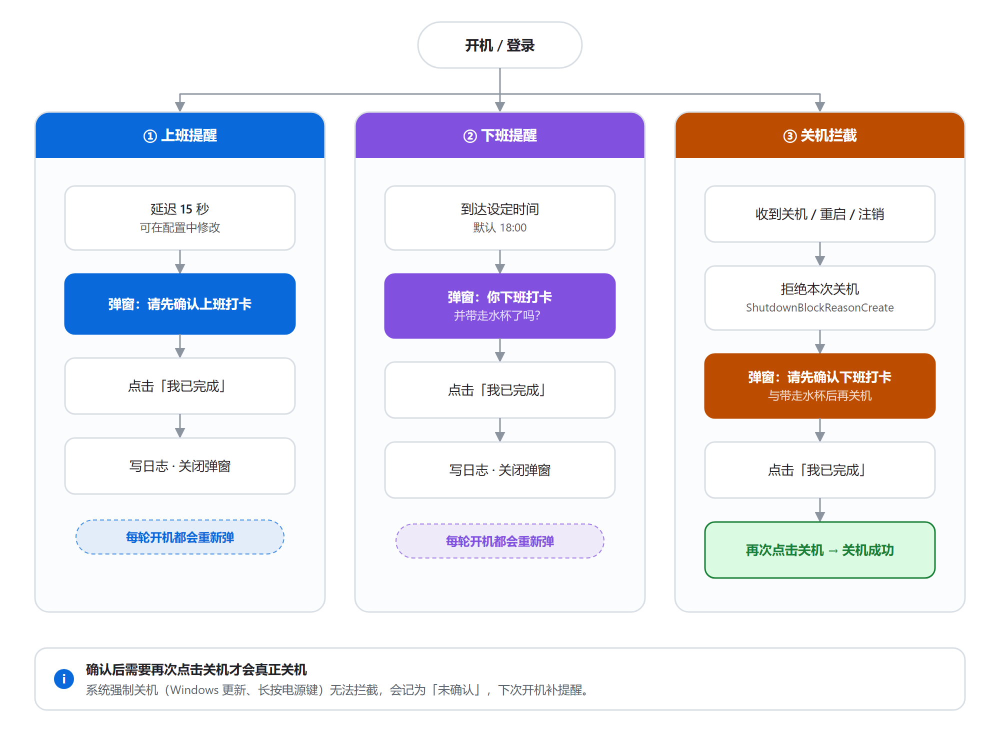
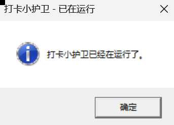

# 打卡小护卫 · PunchPal

> 一个只有几百 KB 代码量、却能替你守住「上班打卡 / 下班打卡 / 关机前确认」的 Windows 桌面小工具。

开机 15 秒后提醒你确认上班打卡，到点提醒你下班打卡，关机前拦你一下——点了「我已完成」才放行。忘确认就强制关机？下次开机会补提醒。

<p align="center">
  
  
  
</p>

<p align="center">
  <sub>上班提醒 · 下班提醒 · 关机前拦截确认</sub>
</p>

---

## ✨ 特性

| 特性 | 说明 |
| --- | --- |
| 开机提醒 | 开机自启，延迟 N 秒（默认 15 秒）弹出「请先确认上班打卡」 |
| 下班提醒 | 到达设定时间（默认 `18:00`）弹出下班打卡提醒，每 30 秒轮询一次 |
| 关机拦截 | 拦截关机 / 重启 / 注销，弹确认框；未确认则拒绝关机 |
| 一天多轮 | **每轮开机都会重新提醒，每次关机都会重新拦截**，不受"当天已确认"影响 |
| 未确认补偿 | 强制关机且未确认时记账，下次开机补一条「上次关机未确认」提醒 |
| 全量自定义 | 文案、按钮文字、配色、字体、图标、提示音、置顶、时间全部可改 |
| 系统托盘 | 常驻托盘，右键可手动确认打卡、打开配置、开关自启、退出 |
| 单实例 | 命名 Mutex 保证只有一个进程，重复启动会提示 |
| 零依赖 | 单文件自包含发布，目标机器无需安装 .NET 运行时 |
| 不联网 | 无任何网络请求，配置与日志只存在本机 |

---

## 🔄 它是怎么工作的

<picture>
  <source media="(prefers-color-scheme: dark)" srcset="docs/diagrams/workflow-dark.png">
  <source media="(prefers-color-scheme: light)" srcset="docs/diagrams/workflow-light.png">
  
</picture>

**关键点**：确认后系统挂起的关机流程不会自动继续，需要你再点一次关机才真正关机——这是刻意设计，确保你有机会"改主意"。

---

## 🚀 快速开始

现在的 AI IDE（Codex、DSH、Trae、WorkBuddy之类） 都非常强大，所以可以直接对 AI 说 “请帮我把这个项目跑起来” 即可~甚至可以自己对这个项目做改造

### 方式一：直接用发布好的 exe（推荐给普通用户）

1. 下载 `PunchPal.exe`
2. 双击运行（首次运行会自动写入开机自启项）
3. 托盘出现图标，搞定

> 单文件自包含发布，**不需要安装 .NET**。若 SmartScreen 拦截，点「更多信息 → 仍要运行」。

### 方式二：从源码构建（推荐给开发者）

**前置要求**

- Windows 10 / 11
- [.NET 8 SDK](https://dotnet.microsoft.com/download/dotnet/8.0)

```powershell
# 1. 克隆
git clone <your-repo-url>
cd EasyPunchIn

# 2. 还原 + 编译
dotnet build EasyPunchIn/EasyPunchIn.csproj -c Release

# 3. 发布为单文件自包含 exe
dotnet publish EasyPunchIn/EasyPunchIn.csproj `
  -c Release -r win-x64 --self-contained true `
  -p:PublishSingleFile=true `
  -p:IncludeNativeLibrariesForSelfExtract=true `
  -o publish/win-x64

# 4. 运行
.\publish\win-x64\PunchPal.exe
```

### 方式三：打安装包（可选）

需要先安装 [Inno Setup](https://jrsoftware.org/isdl.php)。

1. 先完成上面的 `dotnet publish`，产物在 `publish/win-x64/PunchPal.exe`
2. 用 Inno Setup 打开 `installer/PunchPal.iss`，点击 **Compile**
3. 安装包生成在 `dist/PunchPal-Setup.exe`

---

## ⚙️ 自定义配置

配置文件位置（首次运行自动生成）：

```
%AppData%\PunchPal\config.json
```

托盘右键 → **「打开配置」** 可直接编辑。**修改后重启程序生效。**

仓库中的 [`config.example.json`](config.example.json) 是一份可直接复制的完整示例。

### 完整字段说明

| 字段 | 类型 | 默认值 | 说明 |
| --- | --- | --- | --- |
| `Title` | string | `打卡提醒` | 上班提醒的窗口标题 |
| `ClockInBody` | string | `请先确认上班打卡` | 上班提醒正文；留空则回退到 `Body` |
| `ClockOutTitle` | string | `下班啦` | 下班提醒的窗口标题 |
| `ClockOutBody` | string | `你下班打卡并带走水杯了吗？` | 下班提醒正文；留空则回退到 `Body` |
| `Body` | string | `请确认您已完成打卡。` | 通用兜底正文 |
| `ButtonText` | string | `我已完成` | 所有弹窗的确认按钮文字 |
| `BackgroundColor` | string | `#2D2D30` | 弹窗内容区背景色 |
| `TextColor` | string | `#FFFFFF` | 弹窗文字颜色 |
| `AccentColor` | string | `#4A4A4A` | 按钮颜色 |
| `FontName` | string | `Microsoft YaHei` | 字体名称 |
| `FontSize` | number | `14` | 字号 |
| `IconPath` | string | `""` | 自定义图标路径，留空用系统默认 |
| `SoundPath` | string | `""` | 提示音文件路径（wav），留空则不响 |
| `TopMost` | bool | `true` | 弹窗是否置顶 |
| `ClockInReminderDelaySeconds` | int | `15` | 开机后延迟多少秒弹上班提醒 |
| `ClockOutTime` | string | `18:00` | 下班提醒时间（24 小时制 `HH:mm`） |
| `ShutdownConfirmText` | string | `请先确认下班打卡与带走水杯后再关机` | 关机确认框正文 |
| `LockOnEveryShutdown` | bool | `true` | `true`=每次关机都拦；`false`=当天已确认下班就不再拦 |
| `AutoStart` | bool | `true` | 是否写入开机自启 |

### 配置示例

```json
{
  "Title": "打卡提醒",
  "ClockInBody": "请先确认上班打卡",
  "ClockOutTitle": "下班啦",
  "ClockOutBody": "你下班打卡并带走水杯了吗？",
  "ButtonText": "我已完成",
  "BackgroundColor": "#2D2D30",
  "TextColor": "#FFFFFF",
  "AccentColor": "#4A4A4A",
  "FontName": "Microsoft YaHei",
  "FontSize": 14,
  "TopMost": true,
  "ClockInReminderDelaySeconds": 15,
  "ClockOutTime": "18:00",
  "ShutdownConfirmText": "请先确认下班打卡与带走水杯后再关机",
  "LockOnEveryShutdown": true,
  "AutoStart": true
}
```

> 💡 程序写出的 JSON 会把中文转义成 `\u6253\u5361` 这种形式，这是 `System.Text.Json` 的默认行为，**不影响使用**，你直接改成中文保存同样有效。

### 托盘菜单

| 菜单项 | 作用 |
| --- | --- |
| 确认上班打卡 | 手动标记今天已完成上班确认 |
| 确认下班打卡 | 手动标记今天已完成下班确认 |
| 显示上班提醒 | 立刻弹一次上班提醒（用来预览效果 / 改配置后验色） |
| 打开配置 | 用默认编辑器打开 `config.json` |
| 开机自启: 开/关 | 一键切换注册表自启项 |
| 退出 | 退出程序（同时放行关机拦截） |

<p align="center">
  
</p>

---

## 📁 项目结构

```
EasyPunchIn/
├── EasyPunchIn.sln
├── EasyPunchIn/
│   ├── EasyPunchIn.csproj    # WinExe / net8.0-windows / WinForms
│   ├── Program.cs            # 单实例 Mutex、开机自启、托盘初始化
│   ├── MainForm.cs           # 关机拦截（WM_QUERYENDSESSION）、定时提醒、托盘菜单
│   ├── ReminderForm.cs       # 弹窗 UI（外观全部来自配置）
│   ├── Config.cs             # JSON 配置读写
│   ├── State.cs              # 跨会话状态（确认日期、未确认计数）
│   ├── Logger.cs             # JSONL 日志
│   ├── ShutdownHelper.cs     # ShutdownBlockReasonCreate/Destroy P/Invoke
│   └── AutoStartHelper.cs    # 注册表开机自启
├── installer/
│   └── PunchPal.iss          # Inno Setup 安装包脚本
├── config.example.json       # 配置示例
└── docs/
    ├── screenshots/          # 弹窗截图
    └── diagrams/             # 流程图
```

---

## 🔧 实现要点（给想看代码的人）

### 1. 关机拦截：靠 `WM_QUERYENDSESSION`

```csharp
protected override void WndProc(ref Message m)
{
    if (m.Msg == WM_QUERYENDSESSION)
    {
        long flags = m.LParam.ToInt64();
        bool critical = (flags & ENDSESSION_CRITICAL) != 0; // 强制关机，拦不住
        bool mustBlock = _config.LockOnEveryShutdown || !IsClockOutConfirmedToday();

        if (!critical && !_allowShutdown && mustBlock)
        {
            m.Result = IntPtr.Zero;      // FALSE = 拒绝关机
            ShutdownHelper.CreateReason(Handle, _config.ShutdownConfirmText);
            return;
        }
        m.Result = new IntPtr(1);        // TRUE = 放行
    }
    ...
}
```

**一个容易踩的坑**：`WM_QUERYENDSESSION` 的 `wParam` 是 *reserved*，真实值**恒为 0**；关机原因在 `lParam` 位掩码里。

- `ENDSESSION_CLOSEAPP = 0x00000001`
- `ENDSESSION_CRITICAL = 0x40000000`（系统强制关机，无法拦截）
- `ENDSESSION_LOGOFF   = 0x80000000`

如果用 `wParam != 0` 判断能否拦截，真实关机时永远判断为"不能拦"，拦截会完全失效。本项目踩过这个坑并已修正。

### 2. 一天多轮提醒：会话级去重

上班 / 下班提醒用**内存标记**去重，而不是"当天已确认过就不再弹"：

```csharp
clockInTimer.Tick += (_, _) =>
{
    clockInTimer.Stop();
    if (!_clockInShownThisSession)
    {
        _clockInShownThisSession = true;
        ShowReminder("clockin", _config.Title, _config.ClockInBody, MarkClockIn);
    }
};
```

这样每轮开机（每次进程启动）都会重新提醒，关机侧则依赖 `LockOnEveryShutdown` 与 `WM_ENDSESSION` 里复位 `_allowShutdown` 保证"每次关都拦"。

### 3. 数据位置

| 文件 | 路径 | 用途 |
| --- | --- | --- |
| 配置 | `%AppData%\PunchPal\config.json` | 全部可自定义项 |
| 状态 | `%AppData%\PunchPal\state.json` | 上次确认日期、未确认次数 |
| 日志 | `%AppData%\PunchPal\log.jsonl` | 每行一条 JSON 事件，便于排查 |
| 自启 | `HKCU\Software\Microsoft\Windows\CurrentVersion\Run\PunchPal` | 当前用户级，无需管理员 |

---

## ❓ 常见问题

<details>
<summary><b>点关机后弹了确认框，点了「我已完成」，为什么还要再点一次关机？</b></summary>

这是设计如此。`ShutdownBlockReasonCreate` 只是"拒绝本次关机请求"，系统不会因为你销毁了阻止原因就自动继续关机，需要你重新发起。这样你确认后仍有机会反悔。
</details>

<details>
<summary><b>为什么有时关机没被拦截？</b></summary>

系统级强制关机（Windows 更新、`ENDSESSION_CRITICAL`、长按电源键、蓝屏）属于不可否决关机，任何用户态程序都拦不住。此时程序会记录一次「未确认」，下次开机补提醒。
</details>

<details>
<summary><b>改了 config.json 没生效？</b></summary>

程序只在启动时读一次配置。改完请在托盘右键「退出」，再重新启动。
</details>

<details>
<summary><b>同一天重启很多次，会重复弹吗？</b></summary>

会。这是刻意设计——每轮开机都会重新提醒一次，每次关机都会重新拦截。如果你只想"当天提醒一次"，可以自行把 `MainForm.cs` 里的会话标记换成日期比较。
</details>

<details>
<summary><b>怎么彻底卸载？</b></summary>

1. 托盘右键 → 退出
2. 删除 `%AppData%\PunchPal\` 整个目录
3. 删除注册表项 `HKCU\Software\Microsoft\Windows\CurrentVersion\Run` 下的 `PunchPal`
4. 删除 exe 本体

用 Inno Setup 安装包安装的，直接走「设置 → 应用 → 卸载」即可（卸载脚本会自动清自启项）。
</details>

<details>
<summary><b>为什么杀毒软件会报警？</b></summary>

单文件自包含 exe 体积大（约 150 MB）、会写注册表自启项、会拦截关机，行为特征容易触发启发式告警。源码全部在本仓库，可自行编译验证。
</details>

---

## 🔒 隐私说明

- **不联网**：程序没有任何网络请求，不上传任何数据。
- **不收集**：不采集账号、不读取文档、不记录键鼠。
- **数据只在本机**：配置、状态、日志全部存放在 `%AppData%\PunchPal\`。
- **仓库不含个人数据**：`.gitignore` 已排除 `config.json` / `state.json` / `log.jsonl` 与所有构建产物。

---

## 📄 说明

个人自用工具，代码结构简单直接，欢迎 fork 改成自己的版本。

如果你也经常忘记打卡，希望它能帮你少被扣几次钱。
